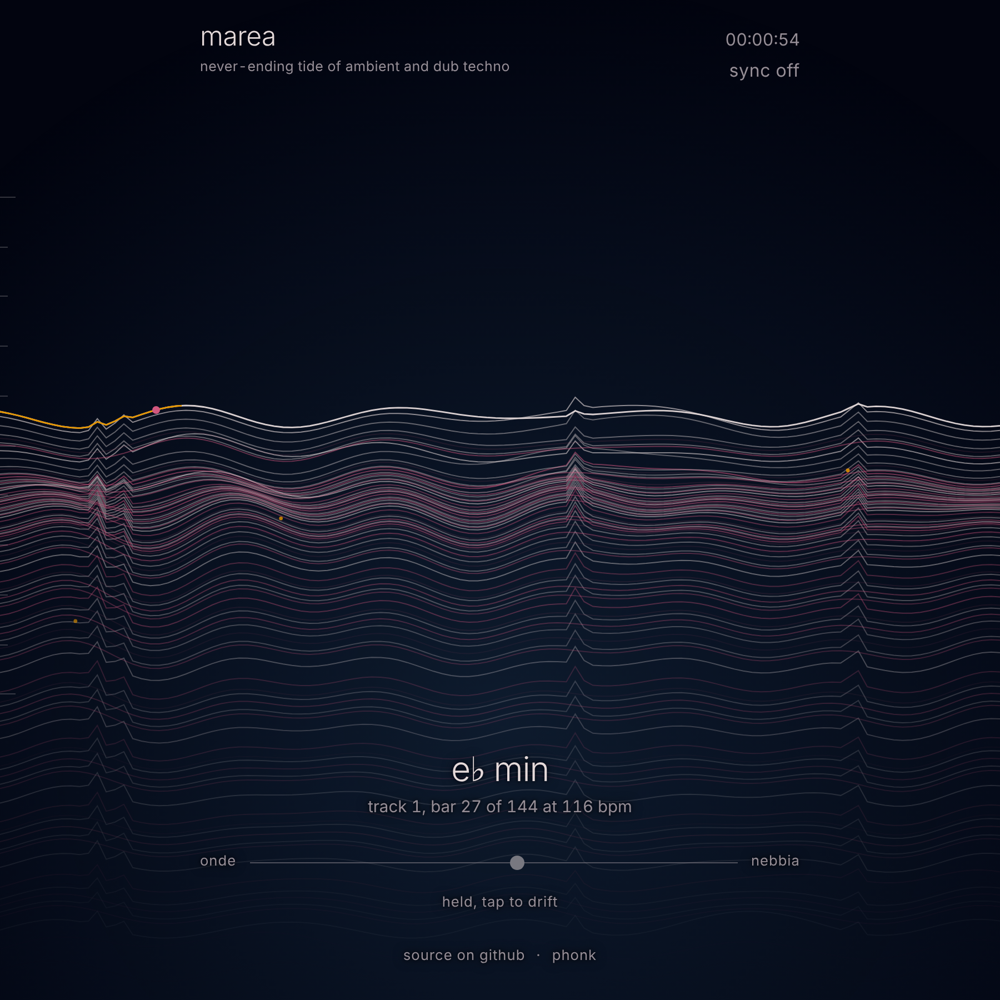

# marea

*never-ending tide of ambient and dub techno*

[nebbia](https://phonk.github.io/nebbia/) and [onde](https://phonk.github.io/onde/) as one piece: it drifts on its own between the two, slow ambient rising into dub techno and falling back, never the same way twice. One HTML file, no samples, no dependencies, no install.

**▶ Play it: [phonk.github.io/marea](https://phonk.github.io/marea/)**

## Play

Tap the page to start, tap again to stop. Everything else happens on its own: the tide rises and falls between the two moods at its own pace.

The slider at the bottom shows where the tide stands, between **onde** and **nebbia**. Drag it to hold the tide where you want — the label above switches from *drifting* to *held*. Let go, or tap it again, and the tide drifts on its own once more.

## What you see

The page is a tide gauge. The bright line is the water: it stands where the tide is, and its shape is the chord that is sounding, one ripple per voice.

Everything the music does leaves a line behind at that level, and the lines sink and fade:

- a kick leaves a line with notches. The notches stay in the same places for a whole track, so they stack into veins; a new track moves them;
- a dub chord leaves a pink line, and its echoes after it;
- the slow pulse of onde leaves a soft line with a swell;
- the high pings are grains of amber that drop on the water and go down with the rest;
- the first line of a new track is amber.

The amber stretch of the water is how far the track has gone, and the dot riding it is the bar. What is on the page is the record of the last minute or two of the piece, drawn by the piece, and it never comes out the same twice. Stop it and the drawing stays.

## Why it works

nebbia runs at 114–120bpm, onde at 52–62bpm — almost exactly half. The tide crossfades the two pieces continuously on that shared pulse, so the music never has to cut from one to the other: it just slowly becomes the other.

## MIDI clock

Tap **sync** to move between *off*, *out* and *in*.

- **sync out**: marea is the master. It sends Start on a bar line, 24 clocks per quarter note at the current tempo, and Stop when you stop it. It sends to every connected MIDI port.
- **sync in**: marea follows the incoming clock. External Start and Stop start and stop it, and the tempo no longer drifts.

This needs Web MIDI: Chrome, Edge or Firefox on a computer or on Android. Safari and iPhone do not have it.

## Notes

- It can run for as long as you leave it open, and keeps playing with the phone screen off.
