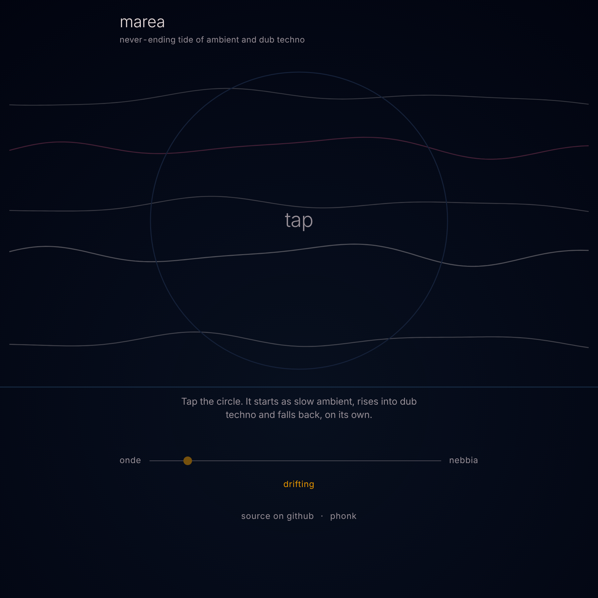

# marea

*never-ending tide of ambient and dub techno*

[nebbia](https://phonk.github.io/nebbia/) and [onde](https://phonk.github.io/onde/) as one piece: it drifts on its own between the two, slow ambient rising into dub techno and falling back, never the same way twice. One HTML file, no samples, no dependencies, no install.

**▶ Play it: [phonk.github.io/marea](https://phonk.github.io/marea/)**

## Play

Tap the circle to start, tap again to stop. Everything else happens on its own: the tide rises and falls between the two moods at its own pace.

The slider under the circle shows where the tide stands, between **onde** and **nebbia**. Drag it to hold the tide where you want — the label above switches from *drifting* to *held*. Let go, or tap it again, and the tide drifts on its own once more.

## What you see

The lines across the page are the voices of the music. At low tide, deep in onde, they stretch edge to edge, slow and wide. As the tide rises toward nebbia they gather inward and curl into rings inside the circle, in step with the beat.

## Why it works

nebbia runs at 114–120bpm, onde at 52–62bpm — almost exactly half. The tide crossfades the two pieces continuously on that shared pulse, so the music never has to cut from one to the other: it just slowly becomes the other.

## MIDI clock

Tap **sync** to move between *off*, *out* and *in*.

- **sync out**: marea is the master. It sends Start on a bar line, 24 clocks per quarter note at the current tempo, and Stop when you stop it. It sends to every connected MIDI port.
- **sync in**: marea follows the incoming clock. External Start and Stop start and stop it, and the tempo no longer drifts.

This needs Web MIDI: Chrome, Edge or Firefox on a computer or on Android. Safari and iPhone do not have it.

## Notes

- It can run for as long as you leave it open, and keeps playing with the phone screen off.
